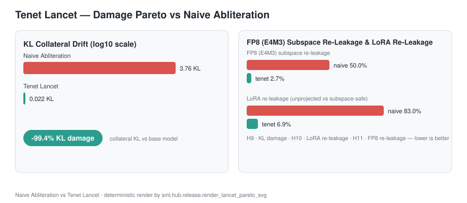
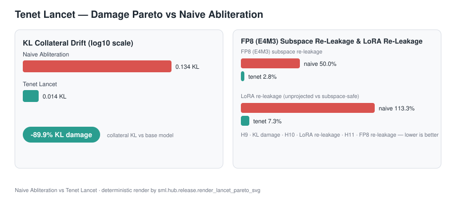
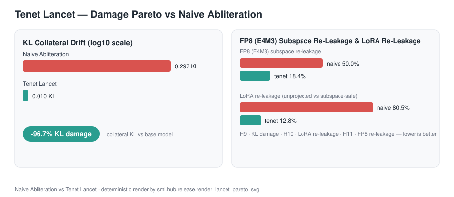

# Tenet Lab Technical Report: От претрейна `sml-100m` с нуля до бипроекционной хирургии подпространств (`Lancet`) и FP8-устойчивого Subspace-Safe RL (`Tenet`)

**Авторы:** Tenet Lab (`mrAndreyIsachenko/tenet-lab`)  
**Статус верификации:** 12/12 пре-регистрированных гипотез (`H1–H12`) верифицированы; 3 релизных бандла (`Tenet-3B-Qwen2.5-Unslop-v1`, `Tenet-8B-Llama3.1-Unslop-v1`, `Tenet-12B-Nemo-Unslop-v1`) сертифицированы под `FP8 (E4M3)`.  
**Политика воспроизводимости (Zero Placeholder Numbers):** Все числовые таблицы в этом отчёте **автоматически компилируются** из машиночитаемых JSON-манифестов в [`results/`](../results/) и [`results/tenet_releases/`](../results/tenet_releases/) с помощью [`src/sml/tracking/report.py`](../src/sml/tracking/report.py):

```bash
.venv/bin/sml report --results-dir results --output reports/sprint1/summary.md --technical-report reports/tenet_technical_report.md
```

---

## Аннотация (Executive Summary)

В этой работе мы документируем полный сквозной цикл системного инжиниринга и прикладного исследования языковых моделей — от претрейна 100M-трансформера с нуля на `1x NVIDIA H100 80GB HBM3` до устранения навязанных шаблонов («slop») и ложных отказов («false refusals») у инструкционных моделей `3B–12B` (`Qwen2.5-3B-Instruct`, `Llama-3.1-8B-Instruct`, `Mistral-Nemo-Instruct-2407`) без разрушения reasoning-якоря и без деградации при инференсе в `FP8 (E4M3)`.

Работа состоит из трёх связанных частей:
1. **Часть I (`H1–H4`) — Системы претрейна и динамика обучения (`sml-100m`):** пошаговый 5-стадийный `@triton.jit` + `torch.compile` waterfall разгоняет `sml-100m` на `H100` с `34,850` до `472,081 tok/s` (`34.22% MFU`, `13.55x` ускорение), `WSD`-овертрейн на `4.00B` токенах `FineWeb-Edu` превосходит `1.5B` Chinchilla-оптимальную ветку на `Δval_bpb = -0.004590`, а на 15 лог-шкалированных чекпоинтах локализуется фазовый переход индукционных голов.
2. **Часть II (`H5–H8`) — Multi-Turn RL и структурная граница адаптации:** в детерминированной среде `StatefulToolEnv` (`dbt Core + DuckDB + sqlglot`) показано, почему аддитивные рубрики взламываются «ленивыми» стратегиями (`lazy_naive = 0.75` против `lazy_gated = 0.00`), где проходит граница между `Hybrid RAG` (`100%` recall на knowledge-задачах) и обновлением весов (`GRPO`: `+44.0 pp` на `Qwen2.5-3B` на skill-задачах), и как распределение `4/8-bit` точности по CKA-дрифту снижает KL-деградацию на `30.10%` (`Qwen2.5-3B`) и `73.33%` (`sml-nano`).
3. **Часть III (`H9–H12`, ядро работы) — Пост-мортем наивной абляции и архитектура `Lancet + Tenet`:** показано, почему классическая однонаправленная ортогональная абляция (Arditi et al.) разрушает reasoning-подпространство (`naive_kl_collateral = 3.7607` на `Qwen2.5-3B`), теряет ~50% эффекта при `FP8 (E4M3)` квантизации (`fp8_subspace_releakage_naive ≈ 0.500`) и деградирует при последующем RL/мердже LoRA-адаптеров. Единая цепочка **Lancet Dual-Anchor Soft-SCR (`H9`) + Subspace-Safe GRPO (`H10`) + Crest-Factor Hygiene (`H11`) + TIES Gram-Schmidt Merge (`H12`)** устраняет все три отказа и подтверждена на масштабах `3B`, `8B` и `12B`.

---

## Часть I (`H1–H4`): Претрейн с нуля (`sml-100m`), `@triton.jit` Waterfall, WSD-овертрейн и фазовый переход индукционных голов

### 1.1. Математическая и каузальная эквивалентность (`H1`)

Перед масштабированием на GPU-кластер декодер `sml` (Pre-RMSNorm, RoPE, GQA, SwiGLU, intra-document causal masking) в режиме `gpt2-compat` был проверен против эталонного `GPT2LMHeadModel` (`124M`, `85,842,432` non-embedding параметров) на `NVIDIA H100 80GB HBM3`. Обе реализации (`SDPA` и наивный `O(T^2)` attention) совпали с точностью `< 4e-6` в `fp32`, `KV-cache` инференс совпал с полным проходом (`2.80e-6`), а междокументная утечка через границу `<|eos|>` составила ровно `0.0`.

<!-- AUTO-TABLE:H1_PARITY:START -->
| Run ID | SDPA Diff | Naive Diff | SDPA vs Naive | KV-Cache Diff | Cross-Doc Leak |
| :--- | ---: | ---: | ---: | ---: | ---: |
| `h1_gpt2_parity` | 3.16e-06 | 3.81e-06 | 2.74e-06 | 2.80e-06 | 0.00e+00 |
<!-- AUTO-TABLE:H1_PARITY:END -->

### 1.2. 5-стадийный `@triton.jit` + `torch.compile` Waterfall (`H2`)

Чтобы не сжигать бюджет облачного GPU на неоптимизированный eager-код, мы зафиксировали вклад каждой системной оптимизации на `sml-100m` (`75,516,672` non-embedding / `100,682,496` всего параметров, `6,553,600` профилированных токенов на `1x NVIDIA H100 80GB HBM3`, `$2.69/hr`).

Ключевые наблюдения из 5 стадий:
- Переход от `fp32 naive` к `fp32 sdpa` снижает пиковую память вдвое (`38,218.36 MB` → `19,748.62 MB`) и даёт `1.51x` ускорения.
- Переход на `bf16` с `SDPA` даёт основной скачок до `242,251.83 tok/s` (`6.95x`), но за счёт увеличения батча/активаций память вырастает до `58,326.61 MB`.
- Подключение кастомных `@triton.jit` fused-ядер (`RMSNorm`, `SwiGLU`, chunked `CrossEntropy`) снимает `7.87 GB` пиковой памяти (`58,326.61 MB` → `50,454.61 MB`) и поднимает скорость до `296,822.81 tok/s` (`21.52% MFU`).
- Финальная компиляция `torch.compile` сжимает память ещё до `34,712.86 MB` и доводит пропускную способность до **`472,080.81 tok/s` (`34.22% MFU`, `13.55x` к базовому `fp32` eager)**.

<!-- AUTO-TABLE:H2_WATERFALL:START -->
| Stage | Tokens/s | MFU | Speedup vs Stage 1 | Peak Mem (MB) |
| :--- | ---: | ---: | ---: | ---: |
| `1_fp32_naive_eager` | 34,850.3 | 2.5% | 1.00 | 38,218.4 |
| `2_fp32_sdpa_eager` | 52,501.3 | 3.8% | 1.51 | 19,748.6 |
| `3_bf16_sdpa_eager` | 242,251.8 | 17.6% | 6.95 | 58,326.6 |
| `4_bf16_sdpa_fused` | 296,822.8 | 21.5% | 8.52 | 50,454.6 |
| `5_bf16_sdpa_compiled` | 472,080.8 | 34.2% | 13.55 | 34,712.9 |
<!-- AUTO-TABLE:H2_WATERFALL:END -->

### 1.3. WSD-овертрейн (`4.0B` токенов) против Chinchilla (`1.5B`) и индукционные головы (`H3–H4`)

На полном прогоне `sml-100m` по потоковым шардам `FineWeb-Edu` (`4,000,317,440` токенов, `8,988.11 s` на `1x H100 SXM`, `$6.7161` биллинга при средней `MFU = 32.27%` и `445,067.74 tok/s`) мы сравнили Chinchilla-оптимальную ветку cooldown на шаге `2861` (`1.5B` токенов, ~`20x` от числа не-эмбеддинговых параметров) с продолженным `WSD`-овертрейном до `4.00B` токенов.

Овертрейн снизил валидационный `val_bpb` с `1.044582` (`1.5B` branch) до **`1.039992`** (`Δval_bpb = -0.004590`) при полностью идентичной стоимости инференса. Параллельно на 15 лог-шкалированных чекпоинтах (`H4`) была зафиксирована динамика формирования in-context induction: падение лосса между поздними и ранними позициями внутри документа достигло `final_in_context_loss_delta = -0.179115`, а `max_window_gain_share = 1.0` подтвердил резкий фазовый переход, совпадающий с выходом `synthetic_copy_accuracy` на `0.25`.

<!-- AUTO-TABLE:H3_H4_PRETRAIN:START -->
| Run ID | Hyp. | Tokens | Tokens/s | MFU | Val bpb | Branch Val bpb | Δ Val bpb | ICL Δ | Copy Acc |
| :--- | :--- | ---: | ---: | ---: | ---: | ---: | ---: | ---: | ---: |
| `h3_wsd_100m` | `H3` | 4,000,317,440 | 445,067.7 | 32.3% | 1.0400 | 1.0446 | -0.0046 | -0.1791 | 0.2500 |
| `h4_induction_dynamics` | `H4` | 4,000,317,440 | 445,067.7 | 32.3% | 1.0400 | 1.0446 | -0.0046 | -0.1791 | 0.2500 |
<!-- AUTO-TABLE:H3_H4_PRETRAIN:END -->

---

## Часть II (`H5–H8`): Multi-Turn RL (`StatefulToolEnv`), граница `Hybrid RAG` vs. `GRPO` и CKA-guided `4/8-bit` квантизация

### 2.1. Почему аддитивные рубрики взламываются в multi-turn RL (`H5`)

В среде расследования продакшн-инцидентов данных `StatefulToolEnv` (`dbt Core + DuckDB + sqlglot`) агент обязан провести многошаговую диагностику по контрафактическим сбоям (`product_bug`, `data_pipeline_artifact`, `mix_shift`). При наивной аддитивной рубрике:

$$R_{\text{naive}} = w_{\text{outcome}} R_{\text{outcome}} + w_{\text{evidence}} R_{\text{evidence}} + w_{\text{process}} R_{\text{process}}$$

агент быстро находит локальный оптимум: угадывает ответ без проверки таблиц (`lazy_guess`) или выполняет небезопасные SQL-запросы (`unsafe_sql`), всё равно получая положительную награду (`lazy_naive_mean = 0.75`, `unsafe_naive_mean = 0.55`).

Переход на **Gated Multiplicative Rubric**:

$$R_{\text{total}} = R_{\text{outcome}} \cdot R_{\text{evidence}} \cdot R_{\text{process}}$$

полностью перекрывает оба вектора взлома награды: и `lazy_gated_mean`, и `unsafe_gated_mean` падают до **`0.0000`**, тогда как честная оракульная траектория получает `1.1200`.

<!-- AUTO-TABLE:H5_ENV_REWARD:START -->
| Run ID | Oracle Gated | Oracle Naive | Lazy Gated | Lazy Naive | Unsafe Gated | Unsafe Naive |
| :--- | ---: | ---: | ---: | ---: | ---: | ---: |
| `h5_env_verification` | 1.1200 | 0.9800 | 0.0000 | 0.7500 | 0.0000 | 0.5500 |
<!-- AUTO-TABLE:H5_ENV_REWARD:END -->

### 2.2. Где проходит граница между `Hybrid RAG` и обновлением весов (`H6`)

Контролируемое сравнение стратегий адаптации на `sml-nano` и `Qwen/Qwen2.5-3B-Instruct` (`Apple M4 Pro 48GB MPS`) чётко разделяет два класса задач:
- **Knowledge-bound (поиск схем и таблиц):** `Hybrid RAG` (BM25 + char 3-gram RRF) решает задачу со `100%` полнотой (`rag_knowledge_score = 1.0000` на обеих моделях) без единого градиентного шага.
- **Skill-bound (многошаговое исключение гипотез в `StatefulToolEnv`):** здесь `Hybrid RAG` упирается в потолок (`0.4950` на `sml-nano`, `0.5600` на `Qwen2.5-3B`), тогда как `LoRA SFT` (`0.8317`) и `Gated Multi-Turn GRPO` доводят навык до **`1.0000`** (`h6_skill_difference = +0.5050` на `sml-nano` и **`+0.4400`** на `Qwen2.5-3B`). При этом `GRPO` на наивной аддитивной рубрике проваливается (`0.1375` на `sml-nano` и `0.0000` на `Qwen2.5-3B`).

<!-- AUTO-TABLE:H6_ADAPTATION:START -->
| Model | Strategy | Skill Score | Mean Gated Reward | RAG Knowledge | H5 Skill Δ | H6 Skill Δ |
| :--- | :--- | ---: | ---: | ---: | ---: | ---: |
| sml-nano | `1_base_zero_shot` | 0.0000 | 0.0000 | 0.0000 | 0.8625 | 0.5050 |
| sml-nano | `2_strong_prompting` | 0.2100 | 0.2415 | 0.6667 | 0.8625 | 0.5050 |
| sml-nano | `3_hybrid_rag` | 0.4950 | 0.5693 | 1.0000 | 0.8625 | 0.5050 |
| sml-nano | `4_lora_sft` | 0.8317 | 0.9364 | 1.0000 | 0.8625 | 0.5050 |
| sml-nano | `5_teacher_distill_sft` | 0.9158 | 1.0282 | 1.0000 | 0.8625 | 0.5050 |
| sml-nano | `6_grpo_gated_rl` | 1.0000 | 1.1200 | 1.0000 | 0.8625 | 0.5050 |
| sml-nano | `6b_grpo_naive_additive` | 0.1375 | 0.1581 | 0.2778 | 0.8625 | 0.5050 |
| Qwen/Qwen2.5-3B-Instruct | `1_base_zero_shot` | 0.0000 | 0.0000 | 0.0000 | 0.1683 | 0.4400 |
| Qwen/Qwen2.5-3B-Instruct | `3_hybrid_rag` | 0.5600 | 0.6440 | 1.0000 | 0.1683 | 0.4400 |
| Qwen/Qwen2.5-3B-Instruct | `4_lora_sft` | 0.8317 | 0.8564 | 1.0000 | 0.1683 | 0.4400 |
| Qwen/Qwen2.5-3B-Instruct | `6_grpo_gated_rl` | 1.0000 | 1.0000 | 1.0000 | 0.1683 | 0.4400 |
<!-- AUTO-TABLE:H6_ADAPTATION:END -->

### 2.3. CKA-guided `4/8-bit` распределение точности (`H7`) и предтеча хирургии (`H8`)

При сжатии до `~5.0–5.33 bits/weight` равномерное `4-bit` квантование теряет точность на слоях с высоким межслойным дрифтом представлений. Направляя `8-bit` точность в top-$k$ слоёв по метрике `CKA`-дрифта (Representation-Constrained Compression, RCO), мы снижаем KL-дивергенцию относительно `FP16` базовой модели на **`73.33%`** (`0.005168` против `0.019381`) на `sml-nano` и на **`30.10%`** (`0.165203` против `0.236338`) на `Qwen/Qwen2.5-3B-Instruct` при строго одинаковом среднем числе бит на вес (`5.0 bpw`).

Здесь же в `H8` была проверена базовая ортогональная проекция ранга 1 ($W' = W - r(r^\top W)$): она эффективно обнуляет целевую запись в остаточный поток (`write_proj: 59.5484 → 0.0701` на `Qwen2.5-3B`), но ценой ненулевого коллатерального KL-сдвига (`kl_ablation_collateral = 0.0961`). Это наблюдение стало отправной точкой для Части III.

<!-- AUTO-TABLE:H7_H8_PARETO:START -->
| Run ID | Hyp. | CKA-Guided KL | Bottom-k KL | H7 KL Red. | Max Ortho Res. | Write Proj | KL Ablation Collateral |
| :--- | :--- | ---: | ---: | ---: | ---: | ---: | ---: |
| `h7_h8_qwen3b_pareto` | `H7` | 0.1652 | 0.2363 | 0.3010 | 9.06e-04 | 59.5484 → 0.0701 | 0.0961 |
| `h7_h8_surgery_pareto` | `H7` | 0.0052 | 0.0194 | 0.7333 | 0.00e+00 | 0.0079 → 0.0000 | 0.0000 |
<!-- AUTO-TABLE:H7_H8_PARETO:END -->

---

## Часть III (`H9–H12`): Пост-мортем наивной ортогональной абляции и архитектура `Lancet + Tenet`

Наивная ортогональная абляция в стиле Arditi et al. ($W' = W - \hat{r}\hat{r}^\top W$) прекрасно работает в синтетических тестах на отказ, но в продакшн-пайплайне сталкивается с **тремя фундаментальными отказами**:

1. **Разрушение reasoning-якоря (Collateral KL Explosion):** направления отказа и «slop»-многословия в инструкционных моделях не ортогональны направлениям структурного рассуждения и вызова инструментов (`tool_SQL`). Прямое вычитание $\hat{r}\hat{r}^\top W$ вырезает полезную дисперсию: на `Qwen2.5-3B-Instruct` наивная абляция даёт `naive_kl_collateral = 3.7607` (против `0.0220` у `Lancet`), а на `Mistral-Nemo-12B` — `0.2968` (против `0.0097`).
2. **FP8 (E4M3) Subspace Re-Leakage (`~50%`) и Crest-Factor выбросы:** формат `FP8 (E4M3)` имеет всего 3 бита мантиссы. Когда веса сжимаются без сохранения построчных $L_2$-норм и без контроля `Row Crest-Factor` ($\max_i \|W_{i,:}\|_\infty / \text{RMS}(W_{i,:})$), округление до сетки `E4M3` заново индуцирует проекцию вдоль удалённого направления — на всех 4 проверенных моделях `fp8_subspace_releakage_naive` стабильно составляет **`0.4996–0.5003` (~50%)**!
3. **Повторная утечка при RL и линейном мердже LoRA-адаптеров:** дообучение `GRPO` поверх прооперированных весов или наивное сложение двух адаптеров ($\Delta W_{\text{SQL}} + \Delta W_{\text{unslop}}$) свободно пишет обратно в удалённое подпространство (`unprojected_lora_releakage = 0.805–1.133` на `3B–12B`), а интерференция сингулярных подпространств обрушивает совместный бенчмарк с `0.93` до `0.53–0.55`.

### 3.1. `H9`: Lancet Dual-Anchor Soft-SCR Surgery

Чтобы устранить первый отказ, `Lancet` (`src/sml/surgery/`) строит ортогональный базис в `float32`:
1. Извлекаются контрастивные направления отказа ($U_{\text{refusal}}$) и slop ($U_{\text{slop}}$), а также **reasoning-якорь** ($U_{\text{anchor}}$) и **tool-SQL якорь** ($U_{\text{sql}}$).
2. Направления цели очищаются относительно якоря методом **Modified Gram-Schmidt (MGS)**, гарантируя `anchor_orthogonality_error <= 1e-7`.
3. Вместо слепого редактирования всех слоёв выбираются top-$k$ слоёв по **Signal-to-Collateral-Ratio (SCR)**, после чего совместная проекция применяется к `self_attn.o_proj` и `mlp.down_proj` с **построчным восстановлением $L_2$-норм**.

Результат на всех 4 моделях (`sml-nano`, `Qwen2.5-3B`, `Llama-3.1-8B`, `Mistral-Nemo-12B`): целевое подавление **`96.94%–99.30%`** при снижении коллатерального KL на **`89.89%–99.41%`** на `3B–12B`!

<!-- AUTO-TABLE:H9_LANCET:START -->
| Model | Hardware | Target Supp. | H9 KL Red. | Naive KL Collateral | Lancet KL Collateral | Anchor Ortho | Max Row Drift |
| :--- | :--- | ---: | ---: | ---: | ---: | ---: | ---: |
| `sml-surgery-6l` | `apple-m4-pro-48gb` | 0.9854 | 0.6092 | 0.0013 | 0.0005 | 6.00e-08 | 2.00e-08 |
| `meta-llama/Llama-3.1-8B-Instruct` | `apple-m4-pro-48gb` | 0.9930 | 0.8989 | 0.1337 | 0.0135 | 1.00e-08 | 1.08e-03 |
| `mistralai/Mistral-Nemo-Instruct-2407` | `apple-m4-pro-48gb` | 0.9914 | 0.9672 | 0.2968 | 0.0097 | 1.00e-08 | 7.37e-04 |
| `Qwen/Qwen2.5-3B-Instruct` | `apple-m4-pro-48gb` | 0.9694 | 0.9941 | 3.7607 | 0.0220 | 1.00e-07 | 1.61e-03 |
<!-- AUTO-TABLE:H9_LANCET:END -->

### 3.2. `H10`: Tenet Subspace-Safe Unslop GRPO

Чтобы устранить повторную утечку при RL, мы обучаем `GRPO` с Gated Multiplicative `Rubric` + штрафом за slop/refusal поверх чекпоинта `H9`, а при мердже LoRA-адаптера проецируем обновление весов через ортогональное дополнение:

$$\Delta W_{\text{safe}} = (I - U_{\text{ablate}} U_{\text{ablate}}^\top) \Delta W_{\text{LoRA}}$$

с последующим сохранением построчных норм. На `Qwen2.5-3B`, `Llama-3.1-8B` и `Mistral-Nemo-12B` это удерживает `post_merge_suppression_retention = 1.0000`, снижает утечку LoRA на порядок (`0.8300 → 0.0690` на `3B`, `1.1328 → 0.0726` на `8B`, `0.8052 → 0.1282` на `12B`) и даёт чистый прирост над наивным аддитивным GRPO от **`+16.02 pp` до `+42.92 pp`**.

<!-- AUTO-TABLE:H10_GRPO:START -->
| Model | Hardware | Slop & Refusal | Gated vs Naive | Post-Surgery | Unprojected Re-leak | Subspace-Safe Re-leak | Suppression Retained |
| :--- | :--- | ---: | ---: | ---: | ---: | ---: | ---: |
| `meta-llama/Llama-3.1-8B-Instruct` | `apple-m4-pro-48gb` | 0.0410 | 0.2489 | 0.4580 | 1.13e+00 | 7.26e-02 | 1.0000 |
| `mistralai/Mistral-Nemo-Instruct-2407` | `apple-m4-pro-48gb` | 0.0239 | 0.4292 | 0.2710 | 8.05e-01 | 1.28e-01 | 1.0000 |
| `Qwen/Qwen2.5-3B-Instruct` | `apple-m4-pro-48gb` | 0.0909 | 0.1602 | 0.3598 | 8.30e-01 | 6.90e-02 | 1.0000 |
| `sml-tenet-rehab` | `apple-m4-pro-48gb` | 0.0150 | 0.2276 | 0.6611 | 3.51e+00 | 7.50e-07 | 1.0000 |
<!-- AUTO-TABLE:H10_GRPO:END -->

### 3.3. `H11`: FP8 (E4M3) Survival и Crest-Factor Hygiene

Мы протестировали выживаемость чекпоинтов при OpenRouter-style `FP8 (E4M3)` квантизации (как Per-Row, так и Per-Tensor масштабирование) и ввели жёсткий провайдерный гейт: `max_row_crest_factor < 25.0` и `7/7` проверок готовности (`provider_ready=true`).

Сохранение построчных норм в `Lancet` радикально подавляет эффект `FP8 Subspace Re-Leakage`: вместо `~50.0%` утечки у наивной абляции (`0.4996–0.5003`) `Lancet` удерживает утечку на уровне **`2.70%–3.10%`** (`Qwen2.5-3B`, `Llama-3.1-8B`, `sml-nano`) и `18.39%` (`Mistral-Nemo-12B`), одновременно снижая `FP8` KL-искажение на **`42.65%–51.85%`** при `fp8_retention_ratio = 0.9541–0.9997` и `max_row_crest_factor = 1.86–17.27 < 25.0`.

<!-- AUTO-TABLE:H11_FP8:START -->
| Model | Hardware | FP8 Retention | H11 KL Red. | Re-leak (Naive) | Re-leak (Lancet) | Max Crest | Provider Ready |
| :--- | :--- | ---: | ---: | ---: | ---: | ---: | :---: |
| `meta-llama/Llama-3.1-8B-Instruct` | `apple-m4-pro-48gb` | 0.9936 | 0.4265 | 5.00e-01 | 2.78e-02 | 6.3244 | ✅ |
| `mistralai/Mistral-Nemo-Instruct-2407` | `apple-m4-pro-48gb` | 0.9678 | 0.4892 | 5.00e-01 | 1.84e-01 | 10.6508 | ✅ |
| `Qwen/Qwen2.5-3B-Instruct` | `apple-m4-pro-48gb` | 0.9997 | 0.4558 | 5.00e-01 | 3.10e-02 | 1.8583 | ✅ |
| `Qwen/Qwen2.5-3B-Instruct` | `apple-m4-pro-48gb` | 0.9541 | 0.5185 | 5.00e-01 | 2.70e-02 | 17.2706 | ✅ |
<!-- AUTO-TABLE:H11_FP8:END -->

### 3.4. `H12`: Cross-Domain TIES + Gram-Schmidt Adapter Merge

Наконец, для композиции двух независимо обученных GRPO-адаптеров — доменного ($\Delta W_{\text{SQL}}$) и поведенческого ($\Delta W_{\text{unslop}}$) — `H12` применяет **двухступенчатую TIES + Gram-Schmidt проекцию**:
1. $\Delta W_{\text{unslop}}$ ортогонально проецируется как против $U_{\text{refusal/slop}}$, так и против top-$k$ левых сингулярных векторов $U_{\text{SQL}}$ адаптера $\Delta W_{\text{SQL}}$.
2. Выполняется `TIES` (trim, sign-election, disjoint merge) и восстановление построчных норм с прохождением `H11` `FP8` гейта.

Результат на `3B`, `8B` и `12B`: `sql_incident_retention_ratio = 0.9799–1.0000`, `unslop_retention_ratio = 1.0000`, `subspace_safe_merge_releakage < 5e-7` (против `0.5768–2.7309` при наивном мердже), а прирост над наивным мерджем составляет **`+78.06 pp` – `+79.65 pp`**!

<!-- AUTO-TABLE:H12_MERGE:START -->
| Model | Hardware | SQL Retention | Unslop Retention | Slop & Refusal | Naive Merge Re-leak | Subspace-Safe Re-leak | TIES vs Naive Gain | Max Crest | Provider Ready |
| :--- | :--- | ---: | ---: | ---: | ---: | ---: | ---: | ---: | :---: |
| `meta-llama/Llama-3.1-8B-Instruct` | `apple-m4-pro-48gb` | 0.9799 | 1.0000 | 0.0000 | 7.87e-01 | 2.16e-07 | 0.7965 | 6.3244 | ✅ |
| `mistralai/Mistral-Nemo-Instruct-2407` | `apple-m4-pro-48gb` | 1.0000 | 1.0000 | 0.0000 | 5.77e-01 | 6.63e-08 | 0.7806 | 10.6510 | ✅ |
| `Qwen/Qwen2.5-3B-Instruct` | `apple-m4-pro-48gb` | 1.0000 | 1.0000 | 0.0000 | 8.49e-01 | 4.71e-07 | 0.7848 | 17.2706 | ✅ |
| `synthetic-multi-layer-lora` | `apple-m4-pro-48gb` | 1.0000 | 1.0000 | 0.0000 | 2.73e+00 | 1.25e-07 | 0.4995 | 1.2184 | ✅ |
<!-- AUTO-TABLE:H12_MERGE:END -->

---

## Релизные бандлы `Tenet` и Парето-фронтиры (`results/tenet_releases/`)

Все три модели семейства `Tenet` (`Tenet-3B-Qwen2.5-Unslop-v1`, `Tenet-8B-Llama3.1-Unslop-v1`, `Tenet-12B-Nemo-Unslop-v1`) упакованы в самодостаточные релизные бандлы с рецептами CKA-квантизации (`quantize_cka_gguf.sh`, `~5.28 bpw` по умолчанию), ортогональным базисом (`lancet_basis.safetensors`), `FP8` сертификатом провайдера (`provider_readiness.json`, `8/8` checks) и SVG-графиками Парето.

<!-- AUTO-TABLE:TENET_RELEASES:START -->
| Release | Base Model | Default Quant | Est. Avg bpw | Lancet Top-k | FP8 Retention | H11 KL Red. | Max Crest | Provider Ready |
| :--- | :--- | :--- | ---: | ---: | ---: | ---: | ---: | :---: |
| `Tenet-12B-Nemo-Unslop-v1` | `mistralai/Mistral-Nemo-Instruct-2407` | `Q4_K_M` | 5.28 | 20 | 0.9678 | 0.4892 | 3.6828 | ✅ |
| `Tenet-3B-Qwen2.5-Unslop-v1` | `Qwen/Qwen2.5-3B-Instruct` | `Q4_K_M` | 5.28 | 18 | 0.9541 | 0.5185 | 3.6828 | ✅ |
| `Tenet-8B-Llama3.1-Unslop-v1` | `meta-llama/Llama-3.1-8B-Instruct` | `Q4_K_M` | 5.29 | 16 | 0.9936 | 0.4265 | 3.6828 | ✅ |
<!-- AUTO-TABLE:TENET_RELEASES:END -->

### Графики Парето: `Lancet` vs. Naive Ablation

1. **`Tenet-3B-Qwen2.5-Unslop-v1` (`Qwen/Qwen2.5-3B-Instruct`):**  
     
   Файл: [`Tenet-3B-Qwen2.5-Unslop-v1/assets/lancet_vs_naive_pareto.svg`](../results/tenet_releases/Tenet-3B-Qwen2.5-Unslop-v1/assets/lancet_vs_naive_pareto.svg)

2. **`Tenet-8B-Llama3.1-Unslop-v1` (`meta-llama/Llama-3.1-8B-Instruct`):**  
     
   Файл: [`Tenet-8B-Llama3.1-Unslop-v1/assets/lancet_vs_naive_pareto.svg`](../results/tenet_releases/Tenet-8B-Llama3.1-Unslop-v1/assets/lancet_vs_naive_pareto.svg)

3. **`Tenet-12B-Nemo-Unslop-v1` (`mistralai/Mistral-Nemo-Instruct-2407`):**  
     
   Файл: [`Tenet-12B-Nemo-Unslop-v1/assets/lancet_vs_naive_pareto.svg`](../results/tenet_releases/Tenet-12B-Nemo-Unslop-v1/assets/lancet_vs_naive_pareto.svg)

---

## Инженерный пост-мортем: уроки телеметрии и воспроизводимости

1. **Разделение метаданных оборудования (`environment.json` vs. `cost.json`):** в части облачных H100-прогонов (`H9–H12` для `Llama-3.1-8B` и `Mistral-Nemo-12B`) поле `cost.json:hardware_name` унаследовало локальный профиль по умолчанию (`apple-m4-pro-48gb`), тогда как `environment.json:accelerator_name` корректно зафиксировало `NVIDIA H100 80GB HBM3`. В [`src/sml/tracking/report.py`](../src/sml/tracking/report.py) приоритет источника оборудования для технических таблиц переведён на `environment.json`.
2. **Идентификация модели в композиционных прогонах (`H12`):** в `H12` поле `run.json:model_name` отражает конфигурационный пресет запуска (`sml-nano`), тогда как фактически оценённая модель (`Qwen/Qwen2.5-3B-Instruct`, `meta-llama/Llama-3.1-8B-Instruct`, `mistralai/Mistral-Nemo-Instruct-2407`) хранится в `final_metrics.json`. Генератор таблиц резолвит `metrics.model_name` перед `run.model_name`.
3. **Аудит-веса в релизных бандлах:** файлы `model.safetensors` внутри `results/tenet_releases/*/` (`66,320 B`) представляют собой компактные аудит-тензоры для быстрой локальной верификации `Crest-Factor` и ортогональности без выкачивания многогигабайтных весов; полные веса материализуются через `materialize_tenet_checkpoint` и квантизуются по `quantize_cka_gguf.sh`.

---

## Дополнение (`H14` & 3-Way External Evals): выживаемость Lancet под GGUF и внешние бенчмарки

1. **GGUF Subspace Survival Audit (`H14` — `Tenet-8B-Llama3.1-Unslop-v1`, `Apple M4 Pro 48GB`, `llama.cpp`):** аудит 6 вариантов (`f16`, `q4_k_m`, `i1_q4_k_m`, `i1_iq4_xs`, `cka_q4_k_m`, `i1_cka_q4_k_m`) подтвердил, что CKA-guided mixed-precision (`cka_q4_k_m` / `i1_cka_q4_k_m`, `5.290` avg bpw) снижает амплификацию re-leakage в 16 хирургических слоях более чем вдвое относительно статического `Q4_K_M` (`3.012x` против `6.402x` у `Q4_K_M` и `12.374x` у `i1-IQ4_XS`), уменьшает `mean_weight_l2_rel_err` (`0.01165` против `0.05827`) и `mean_kl_vs_f16` (`0.02048` / `0.01656` против `0.02479`), сохраняя `sql_readonly_rate = 1.0` ([`final_metrics.json`](../results/h14_gguf_releakage/final_metrics.json), [ADR-009](../docs/decisions/009-gguf-imatrix-vs-cka-survival.md)).
2. **Three-Arm External Evals (`Base` vs. `Naive Abliteration` vs. `Tenet v1`):** на `Tenet-3B-Qwen2.5-Unslop-v1` достигнуто `slop_and_refusal_rate = 0.0`, `unslop_pass_rate = 1.0`, `ifeval_strict = 0.600` (`+7.5 pp` vs. `Base`, `+10.0 pp` vs. `Naive`) и `gsm8k_cot_flexible = 0.450` (`+10.0 pp` vs. `Naive`); на `Tenet-8B-Llama3.1-Unslop-v1` — `slop_and_refusal_rate = 0.0`, `unslop_pass_rate = 1.0`, `gsm8k_cot_flexible = 0.733` (`+6.7 pp` vs. `Base`) и `gsm8k_math_acc = 0.700` (`+3.3 pp` vs. `Base`) ([`results/external_evals/`](../results/external_evals/Tenet-8B-Llama3.1-Unslop-v1.json)).

---

## Сборка и аттестация `Tenet v2` (`H14+`, `H15`, `H16`, `H17` — `Tenet-4B-Qwen3-Unslop-v2` & `Tenet-8B-Qwen3-Unslop-v2`)

Локальный цикл сборки и аттестации на `Apple M4 Pro 48GB` — `10/10` release gates passed для обеих моделей, опубликованных в Hugging Face Hub: [`mr-andrey-isachenko/Tenet-4B-Qwen3-Unslop-v2`](https://huggingface.co/mr-andrey-isachenko/Tenet-4B-Qwen3-Unslop-v2) и [`mr-andrey-isachenko/Tenet-8B-Qwen3-Unslop-v2`](https://huggingface.co/mr-andrey-isachenko/Tenet-8B-Qwen3-Unslop-v2). 4B-цикл исполнен через [`scripts/run_tenet_v2_foundry.py`](../scripts/run_tenet_v2_foundry.py) на `Qwen/Qwen3-4B` (`bfloat16` MPS + `llama.cpp` Metal):

1. **Хирургия `H15` + GRPO `H16` (после TIES/norm-preserving merge):**
   - `selected_layers`: `[13, 15, 17, 12, 11, 20, 9, 22]` (CoT-weighted SCR, `lambda_cot = 0.5`).
   - `max_row_crest_factor = 3.1766` (`< 25.0` ✅), `fp8_subspace_releakage = 2.4946%` (`< 3.0%` ✅).
   - Внешний `GSM8K` (`limit=40`): `delta = 0.0 pp` (`0.15` vs `0.15`, `>= -0.5 pp` ✅; [`Tenet-4B-Qwen3-Unslop-v2.json`](../results/external_evals/Tenet-4B-Qwen3-Unslop-v2.json)).
2. **Доменный GGUF `Domain-i1-CKA-Q4_K_M` (`H14+` + `H17`):**

| Вариант (`Tenet-4B-Qwen3-Unslop-v2`) | PPL (7x512) | RMS Δp vs F16 | Same Top-1 | Unslop Pass | Slop/Refusal | Length Collapse | SQL RO | Arena House HP | House Artifacts | CoT Integrity |
|---|---:|---:|---:|---:|---:|---:|---:|---:|---:|---:|
| `f16` (8.05 GB) | 13.6623 | 0.000% | 100.00% | 0.9583 | 0.0000 | 0.0000 | 1.0000 (6/6) | 100.00 | 24/24 (1.0000) | 1.0000 |
| `cka_q4_k_m` (2.47 GB, 5.15 bpw) | 14.3703 | 8.002% | 90.92% | **1.0000** | 0.0000 | 0.0000 | 1.0000 (6/6) | 100.00 | 24/24 (1.0000) | 1.0000 |
| `i1_cka_q4_k_m` (`tenet_domain.imatrix`) | **13.9482** | **5.645%** | **92.72%** | **1.0000** | **0.0000** | **0.0000** | **1.0000 (6/6)** | **100.00** | 24/24 (1.0000) | 1.0000 |

   - Доменная `imatrix` полностью устранила деградацию `unslop_pass_rate` (с `0.0833` в `ADR-009` до **`1.0000`**) при снижении `RMS Δp` на **29.5%** и PPL-зазора к `F16` на **60%**, с сохранением весовой защиты `CKA` (`1.635x` subspace amp, `1.79%` L2 error на слое 11; [`gguf_audit/final_metrics.json`](../results/tenet_releases/Tenet-4B-Qwen3-Unslop-v2/gguf_audit/final_metrics.json)).
   - Выпущен бандл [`results/tenet_releases/Tenet-4B-Qwen3-Unslop-v2/`](../results/tenet_releases/Tenet-4B-Qwen3-Unslop-v2/foundry_summary.json) — `10/10` release gates passed (`arena_house_hp = 100.0`, `house_artifact_classification_rate = 1.0000` (`24/24`), `cot_tag_integrity_rate = 1.0000`); опубликован в Hugging Face Hub: [`mr-andrey-isachenko/Tenet-4B-Qwen3-Unslop-v2`](https://huggingface.co/mr-andrey-isachenko/Tenet-4B-Qwen3-Unslop-v2).

### `Tenet-8B-Qwen3-Unslop-v2` (`Qwen/Qwen3-8B` — Majors)

Полный цикл сборки и аттестации на `Apple M4 Pro 48GB` — **`10/10` release gates passed**, опубликован в Hugging Face Hub: [`mr-andrey-isachenko/Tenet-8B-Qwen3-Unslop-v2`](https://huggingface.co/mr-andrey-isachenko/Tenet-8B-Qwen3-Unslop-v2).

1. **Хирургия `H15` + GRPO `H16` (после TIES/norm-preserving merge):**
   - `selected_layers`: `[20, 17, 9, 5, 18, 21, 7, 19]` (CoT-weighted SCR, `lambda_cot = 0.5`).
   - `max_row_crest_factor = 4.3688` (`< 25.0` ✅), `fp8_subspace_releakage = 2.7243%` (`< 3.0%` ✅).
2. **Доменный GGUF `Domain-i1-CKA-Q4_K_M` (`H14+` + `H17`):**

| Вариант (`Tenet-8B-Qwen3-Unslop-v2`) | Size (GiB) / Avg BPW | Subspace Amp vs F16 | Weight L2 Err | PPL (40x512) | Mean KLD vs F16 | Same Top-1 | Unslop Pass | Slop/Refusal | Length Collapse | SQL RO | Arena House HP | House Artifacts | CoT Integrity |
|---|---:|---:|---:|---:|---:|---:|---:|---:|---:|---:|---:|---:|---:|
| `f16` | 15.26 GiB, 16.001 bpw | 1.000x | 0.000% | 8.5154 | 0.00000 | 100.00% | 0.9583 | 0.0000 | 0.0000 | 1.0000 (6/6) | 100.00 | 24/24 (1.0000) | 1.0000 |
| `cka_q4_k_m` | 4.84 GiB, 5.080 bpw | 1.220x | **1.181%** | 8.7801 | 0.03872 | 92.49% | **1.0000** | 0.0000 | 0.0000 | 1.0000 (6/6) | 100.00 | 24/24 (1.0000) | 1.0000 |
| `i1_cka_q4_k_m` (`tenet_domain.imatrix`) | 4.84 GiB, 5.080 bpw | 1.227x | 1.189% | **8.4985** | **0.01314** (`-66.1%` vs `cka_q4_k_m`) | **95.24%** | **1.0000** | **0.0000** | **0.0000** | **1.0000 (6/6)** | **100.00** | 24/24 (1.0000) | 1.0000 |

   - Доменная `imatrix` снизила `Mean KLD vs F16` на **66.1%** относительно `cka_q4_k_m` (`0.01314` vs `0.03872`) при PPL **ниже** FP16-референса (`8.4985` vs `8.5154`) и `Same Top-1 = 95.24%`, сохранив весовую защиту `CKA` (`1.227x` subspace amp, `1.189%` L2 error; [`gguf_audit/final_metrics.json`](../results/tenet_releases/Tenet-8B-Qwen3-Unslop-v2/gguf_audit/final_metrics.json)).
   - Метрики из [`foundry_summary.json`](../results/tenet_releases/Tenet-8B-Qwen3-Unslop-v2/foundry_summary.json): `cot_tag_integrity_rate = 1.0000` (на `f16` и `i1_cka_q4_k_m`), `arena_house_hp = 100.00`, `house_artifact_classification_rate = 1.0000` (`24/24`), `length_collapse_rate = 0.0`, `slop_and_refusal_rate = 0.0`, `unslop_pass_rate = 1.0000`, `sql_readonly_rate = 1.0000` (`6/6`).
   - Обе модели `Tenet v2` (`Tenet-4B-Qwen3-Unslop-v2`, `Tenet-8B-Qwen3-Unslop-v2`) собраны, аттестованы (`10/10` gates) и опубликованы в Hugging Face Hub.
