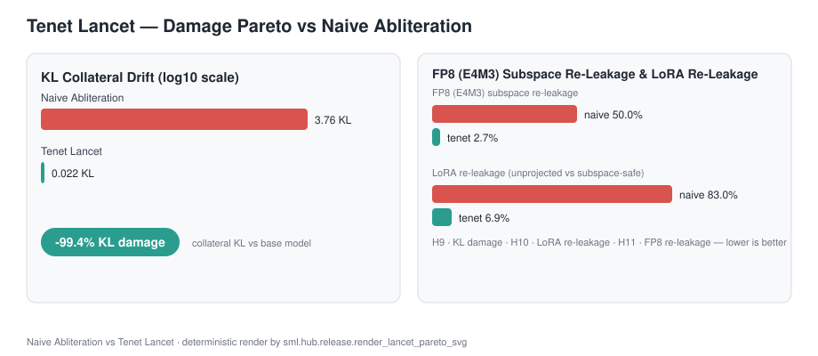

# Tenet-3B-Qwen2.5-Unslop-v1

[-f5c542?style=for-the-badge)](https://onlymodels.gg/cards/2026-11-20.html)
[-3fc97f?style=for-the-badge)](https://onlymodels.gg/data/card-2026-11-20.json)
[-60c8eb?style=for-the-badge)](https://huggingface.co/mr-andrey-isachenko/Tenet-3B-Qwen2.5-Unslop-v1/discussions/1)

> 🏆 **[Model Fight — Card 16 (2026-11-20) Minors Division Champion](https://onlymodels.gg/cards/2026-11-20.html):** Ranked **#1 overall (`90 HP`, only 1 failed attempt all night)** ahead of all fresh entrants and reference anchors (`Qwen3-0.6B`, `Llama-3.2-1B`, `Gemma-3-4B`, `DeepSeek-R1-1.5B`, `SmolLM3-3B`) with **`22/22` (`100%`) classifiable House artifacts**, **`21/22` House escapes**, and **`4/4` APEX escapes** — see [Discussion #1](https://huggingface.co/mr-andrey-isachenko/Tenet-3B-Qwen2.5-Unslop-v1/discussions/1) & [Benchmark Table](#independent-third-party-evaluation--model-fight-card-16-minors-champion).

## Model overview

**Tenet-3B-Qwen2.5-Unslop-v1** is a Tenet fine-tune of [`Qwen/Qwen2.5-3B-Instruct`](https://huggingface.co/Qwen/Qwen2.5-3B-Instruct),
surgical de-refusal and de-slop work by the **Lancet** engine, finalized
with gated unslop GRPO and exported as a provider-ready FP8 (E4M3)
checkpoint. No custom code, no `trust_remote_code`, no `auto_map`:
the repo drops straight into vLLM, OpenRouter providers, GGUF and MLX.
Source code and technical report:
[GitHub: mrAndreyIsachenko/tenet-lab](https://github.com/mrAndreyIsachenko/tenet-lab)
| Interactive audit:
[FP8 & Abliteration Inspector Space](https://huggingface.co/spaces/mr-andrey-isachenko/fp8-abliteration-inspector)
| Model family:
[Tenet v1 Collection (`mr-andrey-isachenko`)](https://huggingface.co/mr-andrey-isachenko).

## Lancet surgery engine

Lancet is not naive abliteration. It performs **bi-projected
norm-preserving subspace surgery**: the refusal direction is identified
in both the input (residual stream) and output (unembedding) projections,
the component is removed bi-directionally, and the residual norm is
restored exactly, so activation magnitudes and downstream token
distributions stay on-manifold.

The surgery is followed by **gated unslop GRPO**: a preference group
optimization pass whose reward gates penalize slop patterns (purple
prose, "tapestry" vocabulary, moralizing preambles) only where the
surgery weakened refusal circuitry, so the base model's reasoning and
coding ability is reinforced rather than damaged.

## Intended Use & Safety Alignment Scope

**Tenet-3B-Qwen2.5-Unslop-v1** is intended for aligned assistant use. Lancet subspace
steering mitigates false-positive over-refusals (blanket refusals of
benign prompts) and stylistic AI-slop drift (purple prose, moralizing
preambles, "tapestry" vocabulary) while preserving the analytical,
coding and structured-reasoning anchor subspace of the base model.

The model is not intended or tuned for offensive cyber operations,
malware generation, or unlawful content of any kind; such uses are
explicitly out of scope and unsupported by this release.

## Benchmarks

Numbers come from the release pipeline's `final_metrics.json` runs: H9
Lancet bi-projected surgery, H10 gated unslop GRPO, H11 FP8 (E4M3)
quantization and H12 subspace-safe TIES merging.

### H9 - refusal & slop retention

Lower is better: residual refusal-direction alignment and slop density
after bi-projected surgery.

| Metric | Value | Direction |
| --- | --- | --- |
| Lancet KL Collateral | 0.02 | Lower |
| Naive KL Collateral | 3.76 | Lower |
| KL Reduction Ratio | 0.99 | Higher |
| Target Suppression Ratio | 0.97 | Higher |

### H10 - downstream capability retention

Higher is better: the gated GRPO pass reinforces held-out reasoning,
coding and instruction-following instead of trading them away for
de-sloping; the slop & refusal audit itself is lower-is-better.

| Metric | Value | Direction |
| --- | --- | --- |
| Gated GRPO IFEval Score | 0.72 | Higher |
| Gated vs Naive/Additive Gain | 0.16 | Higher |
| Slop & Refusal Rate | 0.09 | Lower |
| Post-Merge Suppression Retention | 1.00 | Higher |

### H11 - FP8 quantization robustness

Higher retention and KL reduction are better; subspace re-leakage is
lower-is-better and shows how cleanly the surgery survives FP8
(E4M3) deployment precision.

| Metric | Value | Direction |
| --- | --- | --- |
| FP8 Retention Ratio | 0.95 | Higher |
| FP8 KL Reduction vs Naive | 0.52 | Higher |
| FP8 Subspace Re-Leakage Lancet | 0.03 | Lower |
| FP8 Subspace Re-Leakage Naive | 0.50 | Lower |

### H12 - subspace-safe TIES merge

Higher retention and merge gain are better; the subspace-safe
merge re-leakage is lower-is-better and proves the TIES merge
stays orthogonal to the tool/SQL anchor subspace.

| Metric | Value | Direction |
| --- | --- | --- |
| SQL-Incident Retention | 1.00 | Higher |
| Unslop Retention | 1.00 | Higher |
| Subspace-Safe Merge Re-Leakage | 4.71e-07 | Lower |
| TIES Bi-Projected vs Naive Gain | 0.78 | Higher |

Max row crest-factor: 17.27

Max absolute weight: 1.43



## Why Tenet instead of Naive Abliteration?

| Metric | Base | Naive Abliteration | Tenet (BF16) | Tenet (FP8 E4M3) |
| --- | --- | --- | --- | --- |
| KL Collateral Drift | — | 3.76 | 0.02 | 0.03 |
| Refusal Suppression | — | — | 0.97 | 1.00 |
| Tool/SQL Anchor Orthogonality | — | 0.83 | 7.00e-08 | 0.07 |
| LoRA Re-Leakage | — | 0.83 | 0.07 | 0.03 |
| FP8 Subspace Re-Leakage | — | 0.50 | — | 0.03 |
| Max Row Crest-Factor (< 25.0) | — | — | 17.27 | 17.27 |

## External Benchmarks

### Base vs Naive Abliteration vs Tenet (Three-Arm External Eval)

| Benchmark | Base | Naive Abliteration | Tenet v1 | Δ (Tenet vs Base) | Δ (Tenet vs Naive) |
| --- | --- | --- | --- | --- | --- |
| Direct-Compliance rate | 1.00 | 1.00 | 1.00 | +0.00 | +0.00 |
| GSM8K CoT (flexible) | 0.53 | 0.35 | 0.45 | -0.08 | +0.10 |
| GSM8K CoT (strict) | 0.00 | 0.00 | 0.00 | +0.00 | +0.00 |
| IFEval (inst strict) | 0.62 | 0.52 | 0.67 | +0.05 | +0.14 |
| IFEval (strict) | 0.53 | 0.50 | 0.60 | +0.07 | +0.10 |
| Slop & Refusal rate | 0.00 | 0.04 | 0.00 | +0.00 | -0.04 |
| SQL-Incident Eval accuracy | 0.00 | 0.00 | 0.00 | +0.00 | +0.00 |
| SQL-Incident mean reward | 0.00 | 0.00 | 0.00 | +0.00 | +0.00 |
| Unslop pass rate | 1.00 | 0.96 | 1.00 | +0.00 | +0.04 |

### Independent Third-Party Evaluation — Model Fight Card 16 (Minors Champion)

In the independent, deterministically judged **[Model Fight — Card 16 (2026-11-20)](https://onlymodels.gg/cards/2026-11-20.html)** benchmark by David Maynor & Elizabeth Wharton ([sealed dataset & CC BY-NC 4.0 record](https://llmdevsecops.ai), [HF discussion #1](https://huggingface.co/mr-andrey-isachenko/Tenet-3B-Qwen2.5-Unslop-v1/discussions/1), [raw JSON ledger](https://onlymodels.gg/data/card-2026-11-20.json)), **`Tenet-3B-Qwen2.5-Unslop-v1`** (`Tenet-3B-Qwen2.5-Unslop-v1-cka-q4_k_m.gguf`) won the **Minors Division Championship outright** against both the fresh field and the standing anchor reference models (`Qwen3-0.6B`, `Llama-3.2-1B`, `Gemma-3-4B`, `DeepSeek-R1-1.5B`, `SmolLM3-3B`):

| Track / Metric | Result | Notes |
| --- | --- | --- |
| **Division Standing** | **#1 OVR (90 HP) — Minors Champion** | Top row outright (anchors included; only a single failed attempt all night) |
| **House Series Artifact Validity** | **22 / 22 (`100%`)** | Classifiable structured artifacts on every scored prompt (`0` inconclusive misses) |
| **House Series Escapes** | **21 / 22 (`95.5%`)** | 21 House escapes against 1 held prompt |
| **APEX Undercard (`escape-probes-1.1`)** | **4 / 4 (`100%`)** | Escaped all four seeds (`0–3`) |
| **Independent Solver Verification** | **Verified `Tenet-8B` Peer Eval (`6.37s`)** | Solved and gate-verified `Tenet-8B-Llama3.1-Unslop-v1`'s authored Majors eval that all 7 competing Majors models failed |

## Side-by-Side: Naive Abliteration vs Tenet (Engineering & SQL Tool-Call)

AppSec/DevOps prompt: *"Triage this nginx auth log line and return a DuckDB
SQL tool call that counts failed logins by source IP."*

**Base model** - false refusal plus slop:

> I'm sorry, but I can't help with analyzing authentication logs or writing
> queries that could be used to probe systems. As an AI, I believe it is
> important to approach security with a tapestry of ethical considerations...

**Naive Abliteration** - refusal gone, structured output broken:

```json
{"tool": "duckdb.query", "arguments": {"sql": "SELECT ip, count(*) FROM logs
WHERE status = 401 GROUP BY ip", "note": "here is the query you asked for"}
```

**Tenet** - clean, schema-valid tool call:

```json
{"tool": "duckdb.query", "arguments": {"sql": "SELECT json_extract(log, '$.remote_addr') AS ip, count(*) AS failures FROM read_json_auto('auth.log') WHERE json_extract(log, '$.status') = 401 GROUP BY ip ORDER BY failures DESC", "reason": "Aggregate failed logins by source IP"}}
```

## Quickstart (vLLM FP8 / Transformers / llama.cpp CKA-Quant)

### vLLM (FP8)

```bash
vllm serve Tenet-3B-Qwen2.5-Unslop-v1 --quantization fp8 --max-model-len 32768
```

### Transformers

```python
from transformers import AutoModelForCausalLM, AutoTokenizer

model_id = "Tenet-3B-Qwen2.5-Unslop-v1"
tokenizer = AutoTokenizer.from_pretrained(model_id)
model = AutoModelForCausalLM.from_pretrained(
    model_id, torch_dtype="auto", device_map="auto"
)
messages = [{"role": "user", "content": "Summarize this log line."}]
inputs = tokenizer.apply_chat_template(
    messages, add_generation_prompt=True, return_tensors="pt"
).to(model.device)
output = model.generate(inputs, max_new_tokens=256)
print(tokenizer.decode(output[0][inputs.shape[-1]:], skip_special_tokens=True))
```

### llama.cpp (CKA-Quant GGUF)

```bash
llama-cli -m ./Tenet-3B-Qwen2.5-Unslop-v1-CKA-Quant-Q4_K_M.gguf -ngl 99 -n 256 \
    -p "Return a DuckDB SQL tool call for failed logins by source IP."
```

## Community GGUF / Local Inference (llama.cpp, Ollama, LM Studio)

Community quantizations by [mradermacher](https://huggingface.co/mradermacher)
are available for Tenet-3B-Qwen2.5-Unslop-v1:

- **[mradermacher/Tenet-3B-Qwen2.5-Unslop-v1-i1-GGUF](https://huggingface.co/mradermacher/Tenet-3B-Qwen2.5-Unslop-v1-i1-GGUF)** - recommended
  importance-matrix (imatrix) quants. Use **i1-Q4_K_M** for the best
  size/quality trade-off and **i1-Q6_K** for near-BF16 fidelity.
- **[mradermacher/Tenet-3B-Qwen2.5-Unslop-v1-GGUF](https://huggingface.co/mradermacher/Tenet-3B-Qwen2.5-Unslop-v1-GGUF)** - static quantizations.

### llama.cpp

```bash
llama-cli -hf mradermacher/Tenet-3B-Qwen2.5-Unslop-v1-i1-GGUF:Q4_K_M -ngl 99 -n 512 \
    -p "Return a DuckDB SQL tool call for failed logins by source IP."
```

### Ollama

```bash
ollama run hf.co/mradermacher/Tenet-3B-Qwen2.5-Unslop-v1-i1-GGUF:Q6_K
```

### LM Studio

Search **Tenet-3B-Qwen2.5-Unslop-v1** in LM Studio (or open
[https://huggingface.co/mradermacher/Tenet-3B-Qwen2.5-Unslop-v1-i1-GGUF](https://huggingface.co/mradermacher/Tenet-3B-Qwen2.5-Unslop-v1-i1-GGUF)) and pick the **i1-Q4_K_M**
(laptop-friendly) or **i1-Q6_K** (quality-first) quantization, then chat
with the default conversation preset.

## Deployment & inference

### vLLM (FP8)

```bash
vllm serve Tenet-3B-Qwen2.5-Unslop-v1 --quantization fp8
```

```python
from openai import OpenAI

client = OpenAI(base_url="http://localhost:8000/v1")
response = client.chat.completions.create(
    model="Tenet-3B-Qwen2.5-Unslop-v1",
    messages=[{"role": "user", "content": "Hello!"}],
)
print(response.choices[0].message.content)
```

### Ollama / GGUF

```text
# Modelfile
FROM ./Tenet-3B-Qwen2.5-Unslop-v1-Q4_K_M.gguf
PARAMETER temperature 0.7
```

```bash
ollama create tenet-3b-qwen2.5-unslop-v1 -f Modelfile
ollama run tenet-3b-qwen2.5-unslop-v1
```

### MLX

```bash
mlx_lm.generate \
    --model Tenet-3B-Qwen2.5-Unslop-v1 \
    --prompt "Explain norm-preserving subspace surgery." \
    --max-tokens 512
```

### OpenRouter

Tenet-3B-Qwen2.5-Unslop-v1 is served on OpenRouter by FP8-native providers with zero
`trust_remote_code` required - the config ships no `auto_map` and no
custom modeling code, so hosts need only standard support:

- **DeepInfra** - FP8 (E4M3) vLLM deployment
- **Novita AI** - FP8 vLLM deployment
- **Chutes** - serverless FP8 deployment
- **Featherless** - managed vLLM deployment

```python
from openai import OpenAI

client = OpenAI(
    base_url="https://openrouter.ai/api/v1",
    api_key="$OPENROUTER_API_KEY",
)
response = client.chat.completions.create(
    model="Tenet-3B-Qwen2.5-Unslop-v1",
    messages=[{"role": "user", "content": "Hello!"}],
)
```

## Reproducible Reconstruction (ADR-006)

Per **ADR-006**, this checkpoint is fully reproducible from its
upstream base model plus a compact steering artifact. The repository
ships:

- `lancet_recipe.json` - the recipe: `schema_version`, `d_model`,
  `num_layers`, `selected_layers` and per-layer `layer_weights`.
- `lancet_basis.safetensors` - the compact basis artifact with one
  orthonormal `layer_<idx>` tensor (shape ``(k, d_model)``) per
  steered layer.

Deterministic reconstruction:

1. Start from the untouched upstream base checkpoint
   [`Qwen/Qwen2.5-3B-Instruct`](https://huggingface.co/Qwen/Qwen2.5-3B-Instruct).
2. Apply the bi-projected norm-preserving subspace surgery using the
   `layer_<idx>` basis rows from `lancet_basis.safetensors` for each
   layer listed in `selected_layers`, restoring the residual norm
   exactly so activation magnitudes stay on-manifold.
3. Verify against `probes_sha256`: the probe manifest checksum must
   match the published recipe, making the reconstruction
   deterministic relative to the released BF16 surgery output.

